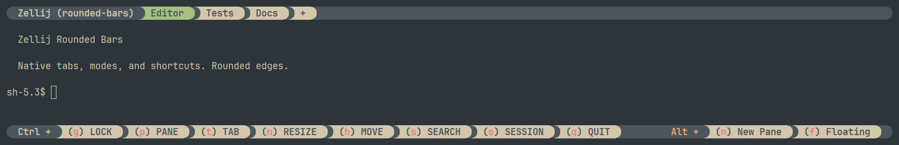
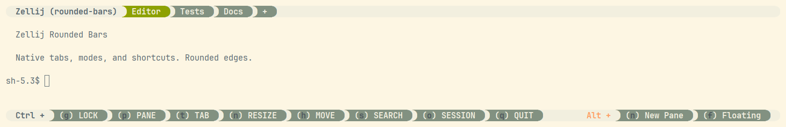

# Zellij Rounded Bars

Native Zellij information and controls, with rounded tab and status bars.

Derived from the `tab-bar` and `status-bar` plugins in **Zellij 0.45.1**. This is an independent community project, not an official Zellij release.

- Rounded outer ends; internal tab, mode, and shortcut separators all curve to the right instead of forming capsules.
- Parenthesized shortcut labels, such as `(p) PANE`, instead of `<p> PANE`.
- Native tabs, scroll indicators, mode-sensitive hints, theme colors, and mouse actions.
- Narrow status bars retain shortcuts that fit, prioritizing the active mode, and fall back to a mode label at tiny widths.
- Two prebuilt WASM files; no custom Zellij executable or local compilation required.

## Preview

**Everforest Dark**



**Everforest Light**



Captured from the running plugins in Zellij 0.45.1, using xterm and JetBrainsMono Nerd Font Mono. The tab bar is at the top; the status bar and native shortcuts are at the bottom.

## Compatibility

The build and CI target **Zellij 0.45.1**. The v0.1.4 resize and interaction smoke tests also passed locally on Zellij 0.46.0; other versions have not been tested. Use a Nerd Font / Powerline-compatible font for `` and ``. The default one-row top and bottom bars are recommended. Existing sessions retain their old plugin instances; start a new session after installation.

## Install v0.1.4

Download `rounded-tab-bar.wasm` and `rounded-status-bar.wasm` from [Releases](https://github.com/yongminari/zellij-rounded-bars/releases/tag/v0.1.4), or run:

```sh
mkdir -p "$HOME/.config/zellij/plugins"
curl -fL https://github.com/yongminari/zellij-rounded-bars/releases/download/v0.1.4/rounded-tab-bar.wasm \
  -o "$HOME/.config/zellij/plugins/rounded-tab-bar.wasm"
curl -fL https://github.com/yongminari/zellij-rounded-bars/releases/download/v0.1.4/rounded-status-bar.wasm \
  -o "$HOME/.config/zellij/plugins/rounded-status-bar.wasm"
```

Merge these aliases into `~/.config/zellij/config.kdl`. Replace `/home/YOUR_USER` with your absolute home path:

```kdl
plugins {
    tab-bar location="file:/home/YOUR_USER/.config/zellij/plugins/rounded-tab-bar.wasm"
    status-bar location="file:/home/YOUR_USER/.config/zellij/plugins/rounded-status-bar.wasm"
}
```

Keep your existing theme, keybindings, and default layout. Layouts that use the `tab-bar` and `status-bar` aliases automatically use these plugins. A custom layout that explicitly uses `zellij:tab-bar` or `zellij:status-bar` must be changed to the aliases.

On first launch, click each permission prompt and press `y`. The plugins request `ReadApplicationState` to display session information and `ChangeApplicationState` for native tab/pane actions. They do not request network or arbitrary command execution permissions. New plugin paths may require permission again.

The release includes `SHA256SUMS`; download it alongside the two files and run `sha256sum -c SHA256SUMS`.

To uninstall, remove the two alias overrides and start a new session.

## Track the latest stable release with Nix

Add a flake input pointing to this repository's main branch:

```nix
inputs.zellij-rounded-bars.url = "github:yongminari/zellij-rounded-bars";
inputs.zellij-rounded-bars.inputs.nixpkgs.follows = "nixpkgs";
```

Use `inputs.zellij-rounded-bars.packages.x86_64-linux.prebuilt` as the directory
containing `rounded-tab-bar.wasm` and `rounded-status-bar.wasm`.
This downloads verified release assets without compiling Rust.
The default package remains the source build for development.

`release.json` tracks the latest published stable release and its hashes.
CI updates it after publishing; drafts, prereleases, and development source
changes do not change the installed binaries. The release-index workflow can
also be dispatched manually to retry a failed index update.

Run `nix flake update zellij-rounded-bars` in your consuming configuration,
then apply Home Manager. Your lock file preserves a reproducible snapshot;
ordinary builds do not silently upgrade. Review Zellij compatibility when
upgrading either Zellij or these plugins.

## Build and test

A Nix flake pins both the upstream source and toolchain. The supported build host is x86_64 Linux; the resulting WASM plugins are portable, although runtime tests currently cover Linux only.

```sh
nix build
nix shell .#test-python .#zellij -c python tests/smoke.py result everforest-dark
nix shell .#test-python .#zellij -c python tests/smoke.py result everforest-light
nix shell .#test-python .#zellij -c python tests/smoke.py result everforest-dark --custom-bindings
```

`result/` contains the two release files. The PTY smoke test checks native information, rounded boundaries, mode transitions, resizing down to six columns and back, and mouse creation of a new tab in an isolated test session. It kills and removes that test session afterward.

## Development and upstream updates

`default-plugins/` contains the derived plugin source. `support/` contains the rounded ribbon renderer. `scripts/prepare.py` overlays these onto the pinned upstream workspace so the original shared crates and Cargo lockfile stay aligned. `upstream.json` records provenance; `flake.lock` pins the build inputs.

This is a source-derived project, not runtime inheritance. Upstream fixes are **not** automatically merged. For an update, review the upstream plugin diff, port changes, update the pinned version and compatibility assertion, then run the build and runtime checks before releasing. Do not assume a new Zellij version is compatible merely because it builds.

CI builds and tests both themes, packages the WASM files and checksums, and uploads
them as a workflow artifact. A separate `Verify packaged release` job downloads
that artifact on a fresh Ubuntu runner, verifies `SHA256SUMS`, and runs both theme
tests against the downloaded files. These checks run for main, pull requests,
tag pushes, and manual runs.

To rehearse a release without creating a tag or publishing a GitHub Release, open
Actions → Build, test, and release → Run workflow and choose the branch to test.
The same build and artifact verification jobs run; publishing and the stable
release index update are skipped. This tests artifact transfer and plugin behavior,
but does not test GitHub Release creation permissions or release-index writes.
Only pushing a `v*` tag publishes the verified files as a GitHub Release.

## License and attribution

MIT, preserving the upstream copyright notice in [LICENSE](LICENSE). The original plugins and shared components are from [zellij-org/zellij](https://github.com/zellij-org/zellij/tree/v0.45.1), copyright Zellij contributors. Rounded rendering and packaging modifications are maintained by yongminari. See [NOTICE](NOTICE) for the starting revision and scope.
